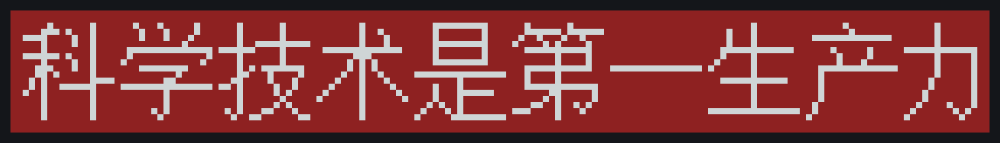
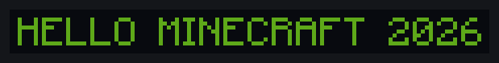
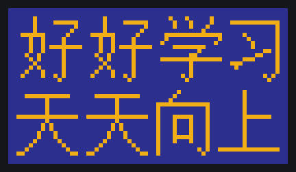

# MC 标语墙投影生成器

把任意文字还原成**完全由游戏内方块搭建、厚度仅 1 格**的标语墙，导出为 Litematica 可直接识别的 `.litematic` 投影文件。



<sub>上图由 `node tools/render-preview.mjs` 直接生成：160×20×1 格，红混凝土 + 白混凝土</sub>

| 纯英文（黑底绿字） | 多行居中（蓝底黄字） |
|---|---|
|  |  |

- **拉丁字母/数字/标点**：原版 **Mojangles** 字形，逐像素取自本机 Minecraft 客户端的字体贴图
- **汉字/中文标点**：**GNU Unifont 16×16** 原生点阵
- **版本感知**：内置 1.20 → 26.3 共 24 个正式版的方块注册表，方块列表随所选版本过滤，写入对应的 `MinecraftDataVersion`，避免"新版本投影拿到旧版本用不了"
- **方块用中文名**：中文名取自游戏本体的 `zh_cn` 语言文件，选择器里显示「红色混凝土（red_concrete）」，命令行也支持直接写中文名
- **候选材质只列完整方块**：从方块模型判定，台阶/栅栏/门/植物/火把等一律排除（详见下文）
- **两种交付**：命令行 `src/cli.mjs` + 单文件网页 `web/slogan-tool.html`（双击即用，可直接在浏览器里下载投影）
- **零依赖**：只用 Node 内置模块，不需要 `npm install`

---

## 安装与首次运行

需要 **Node.js 18+**（<https://nodejs.org/>）和**本机装过、至少启动过一次 Minecraft**。

```bash
git clone https://github.com/Dusktides/mc-slogan-wall.git
cd mc-slogan-wall
node tools/setup.mjs        # 生成运行数据（首次必须，约 2 分钟）
```

Windows 下也可以直接**双击 `start.cmd`**：首次会自动调用 setup，然后打开网页版。

字形、方块中文名、贴图颜色等都派生自 Mojang 的游戏资源，不适合再分发（见 [THIRD-PARTY.md](THIRD-PARTY.md)），
因此仓库中只放代码，数据在首次运行时从本机游戏安装提取，另有两项公开数据需联网下载。
当前状态可用 `node tools/setup.mjs --check` 查看。

### 三个入口

| 入口 | 用途 |
|---|---|
| **双击 `start.cmd`** | 打开网页版：可视化调参、实时预览、直接在浏览器里下载 `.litematic` |
| **`slogan.cmd --text "..." `** | 命令行，参数见下 |
| `node src/cli.mjs --help` | 同上（任意平台） |

想要桌面图标：

```powershell
npm run shortcut     # 或 powershell -ExecutionPolicy Bypass -File tools\create-shortcut.ps1
```
会在桌面和项目根目录各放一个带自定义图标的「MC 标语墙」快捷方式（图标由 `npm run icon` 用
Unifont 的「标」字生成，红底白字，和工具产出的墙同款配色）。

---

## 快速开始

```bash
# 命令行：生成红底白字标语墙（默认红/白混凝土，字间距 1 格、字迹贴边）
node src/cli.mjs --text "科学技术是第一生产力" --border 2 --preview --out slogan.litematic

# 用中文方块名
node src/cli.mjs --text "HELLO" --bg 黑色混凝土 --fg 黄色混凝土 --spacing 2

# 多行居中
node src/cli.mjs --text "好好学习\n天天向上" --align center --line-gap 2

# 查看支持的版本 / 某版本可用的完整方块
node src/cli.mjs --list-versions
node src/cli.mjs --list-blocks --version 1.20.4
node src/cli.mjs --list-blocks 黑 --version 26.3

# 网页版（无需服务器）
#   直接双击 web/slogan-tool.html
```

生成的文件放进 `.minecraft/schematics/`，游戏内 Litematica 菜单即可载入并投影建造。

---

## 命令行参数

| 参数 | 说明 | 默认 |
|---|---|---|
| `-t, --text <文本>` | 标语文本，`\n` 换行 | 必填 |
| `-v, --version <版本>` | 目标游戏版本，`1.20` … `26.3` | `26.3` |
| `--bg <方块>` | 背景材质（中文名 / 裸名 / `minecraft:xxx` 都行） | `红色混凝土` |
| `--fg <方块>` | 字体材质 | `白色混凝土` |
| `--spacing <n>` | 字间距（方块） | `1` |
| `--spacing-mode <m>` | `gap`（默认）/ `advance`，见下 | `gap` |
| `--border <n>` | 距边框距离（方块） | `0` |
| `--line-gap <n>` | 行距（方块） | `1` |
| `--align <a>` | 多行对齐 `left`/`center`/`right` | `center` |
| `--dot-blocks <n>` | 每个点阵像素占几个方块 | `1` |
| `--latin-dots <1\|2\|auto>` | Mojangles 每像素占几个点 | `auto` |
| `--trim` | 裁掉四周全空的边 | 关 |
| `-o, --out <文件>` | 输出路径 | `<文本>.litematic` |
| `--name/--author/--desc` | 投影名与元数据 | — |
| `--no-air` | 材质表里不保留空气 | 关 |
| `--raw` | 输出未压缩 NBT | 关（gzip） |
| `--list-blocks [词]` | 列出所选版本的可用方块（中文/英文关键词过滤） | — |
| `--all-blocks` | 配合 `--list-blocks`：连不完整方块一起列 | 关 |
| `--preview` / `--info` / `--json` | 终端预览 / 回读校验 / JSON 摘要 | — |

方块名三种写法等价：`红色混凝土`、`red_concrete`、`minecraft:red_concrete`；拼错会给出建议（中文按相似度、英文按编辑距离）。

### 尺寸与间距的语义

```
宽度 = 2 × border + 内容墨迹宽
高度 = 2 × border + 内容墨迹高
厚度 = 1（恒定）
```

**关键：边距和间距都以「字形墨迹」为准，不包含字体自带的留白。**

- `--border 0` ⇒ 字迹真正贴到墙边，四条边的边距都是 0 格
- `--border N` ⇒ 四条边的边距都恰好是 N 格
- `--spacing-mode gap`（默认）：`--spacing N` = 相邻字形**墨迹之间**的空格数。`0` 即紧贴，汉字和字母一视同仁
- `--spacing-mode advance`：`N` 叠加在原版字体的字距之上（保留原版排版节奏，例如汉字在原版里字距是 3 格）

行距按字体行高累计；多行默认居中，可用 `--align` 改成左/右对齐。

想量化确认，可以跑 `node tools/measure.mjs`，它会直接打印实测边距与相邻字形的实际空格数：

```
── 纯汉字 · spacing=1 · border=0
   尺寸 63×16  latinDots=2  spacing=1(gap)  border=0
   实际边距  左 0  右 0  上 0  下 0
   字间实际空格  汉+unifont = 1 格
```

---

## 候选材质表只列「完整方块」

方块能不能当墙面，从客户端 jar 的 **blockstates + models** 判定：
沿模型的 parent 链找到 `elements`，要求恰好 1 个元素、无旋转、`from [0,0,0]` 到 `to [16,16,16]`。
所有变体都满足才算完整方块（例如台阶只有 `type=double` 时才是满格，因此不算）。

结果：1288 个方块里 **420 个是完整方块**，其余 868 个被排除，包括

- 不完整方块：台阶、楼梯、围墙、栅栏、栅栏门、玻璃板、铁栏杆等
- 木制衍生品：门、活板门、按钮、压力板、展示架、告示牌等
- 植物：各类花、树苗、草、仙人掌、藤蔓、甘蔗等
- 需要依附其它方块：火把、灯笼、紫水晶簇、梯子、拉杆等
- 装饰与实体方块：头颅、花盆、蛋糕、营火等

并按下列分类展示：

| 分类 | 内容 |
|---|---|
| 混凝土 | 16 色 |
| 羊毛 | 16 色 |
| 带釉陶瓦 | 16 色 |
| 陶瓦 | 16 色 |
| 石英与石材 | 石英、石头、圆石、深板岩、玄武岩、黑石、凝灰岩、安山岩、闪长岩、花岗岩、海晶石及其完整方块形态的变种 |
| 金属与矿物块 | 黑曜石、铁/金/钻石/绿宝石/青金石/红石/煤炭/下界合金块、铜块及其氧化与打蜡变种、粗矿块 |
| 原木与木板 | 各类原木、去皮原木、菌柄、木板、竹块 |
| 其它完整方块 | 剩下的完整方块（泥土、沙子、砂岩、砖块、玻璃、荧石等） |

命令行里仍然可以强行使用任何方块（包括台阶、火把），但会打印警告说明它可能留空隙；
网页端「候选范围」切到「全部方块」就会把不完整方块列出来并标注 `⚠不完整`。

---

## 字形与度量：全部来自原版实测

字宽和基线取自 **26.3 客户端字节码**的反汇编结果：

| | Mojangles（`BitmapProvider`） | 汉字（`UnihexProvider`） |
|---|---|---|
| 单元格 | 8×8（`accented.png` 为 9×12） | 16×16 |
| 字宽 | `(int)(裁剪宽 × scale + 0.5) + 1` | `数据宽/2 + 1` |
| 垂直定位 | `getTop() = 7 - ascent`，基线在行顶下方 7 像素 | `getTop() = 0`，`getBottom() = 16` |
| oversample | `1/scale` | `2`（游戏内 2:1 降采样） |

**关于汉字的一个必要取舍**：原版在游戏里把 16×16 的 Unifont 点阵**降采样到 8×8** 显示，所以中文和拉丁字母看上去一样高。但 8×8 的汉字做成方块墙根本认不出来。因此本工具：

- 汉字按**原生 16×16** 点阵取样（1 点 = 1 方块）
- 拉丁字母在文本含汉字时自动放大 2 倍（`latinDots=2`），与之等高
- 纯 ASCII 文本默认 `latinDots=1`，即 8 格高的紧凑墙面

想改就传 `--latin-dots`；`--dot-blocks N` 可整体放大到 N 个方块/点。

---

## 版本与方块

`data/blocks-by-version.json` 由 `tools/build-blocks-data.mjs` 从 [misode/mcmeta](https://github.com/misode/mcmeta) 的逐版本 block 注册表生成：

- 24 个正式版：`1.20 / 1.20.1 / … / 1.21.11 / 26.1 / 26.1.1 / 26.1.2 / 26.2 / 26.3`
- 1288 个方块，带"存在于哪些版本"的区间信息
- 每版的 `data_version` 写入投影（26.3 = 5023，与客户端 jar 内的 `version.json` 交叉核对一致）

选了旧版本时：
- 网页端方块列表只显示该版本存在的方块
- 命令行用不存在的方块会直接报错，并告诉你它存在于哪些版本

---

## 目录结构

```
src/core/     纯 JS 核心（浏览器与 Node 共用，零依赖）
  glyphs.mjs    字形集：Mojangles + Unifont 统一度量，含墨迹外接矩形
  layout.mjs    文本 → 方块位图（gap/advance 两种字距、多行对齐）
  nbt.mjs       最小 NBT 读写
  schematic.mjs Litematica 位打包与 .litematic 组装
  reader.mjs    独立回读器（校验用）
  blocks.mjs    版本化方块目录 + 中文名 + 完整方块判定 + 分类 + 拼错建议
src/node/     Node 侧数据装载与装配
src/cli.mjs   命令行入口
tools/        构建脚本（数据提取、图标、预览图、打包）
  setup.mjs     一键初始化（幂等）
  lib/          自写的 ZIP 读写与 PNG 编解码（零依赖）
web/          模板 + 生成的单文件预览页（web/slogan-tool.html 不入库）
test/         自动化测试 + litemapy 第三方校验
assets/       icon.ico（由 make-icon.mjs 生成）
docs/         README 用的预览图
start.cmd     双击启动网页版         slogan.cmd  命令行入口
data/         数据产物，全部不入库（见 THIRD-PARTY.md）
```

### 重新构建数据

```bash
node tools/setup.mjs                # 缺什么补什么（推荐，幂等）
node tools/setup.mjs --force        # 全部重建
node tools/setup.mjs --check        # 只检查不生成

# 也可以单独跑某一步
node tools/build-blocks-data.mjs    # 版本化方块目录（需联网）
node tools/extract-mojangles.mjs    # 从本机客户端 jar 提取原版字形
node tools/extract-unifont.mjs      # 下载并提取 Unifont 汉字点阵（需联网）
node tools/build-block-names.mjs    # 从本机资源库的 zh_cn.json 提取方块中文名
node tools/build-block-shapes.mjs   # 从方块模型判定「是否完整方块」
node tools/build-block-colors.mjs   # 从 jar 贴图取预览用平均色
node tools/build-preview.mjs        # 打包单文件 HTML
node tools/make-icon.mjs            # 生成 assets/icon.ico
node tools/render-preview.mjs       # 生成 docs/ 下的预览图
node tools/measure.mjs              # 量化实测边距与字间距
node tools/pack-release.mjs         # 打发行包 dist/*.zip
npm test                            # 46 项自动化测试
```

如果游戏不在默认位置，设置环境变量 `MC_DIR` 指向 `.minecraft` 目录。

> 注意：这些脚本读写 UTF-8 文件。**不要用 Windows PowerShell 5.1 的 `Get-Content`/`Set-Content` 处理它们**——
> 它按 ANSI 读取、按 UTF-8 写回，会把中文全部变成乱码且不可逆。
> 同理，`.ps1` 脚本必须以 **UTF-8 with BOM** 保存，否则 PowerShell 5.1 会按 ANSI 解析出乱码。

---

## 测试与验证

```bash
npm test     # 46 通过 / 0 失败
```

| 检查项 | 覆盖方式 |
|---|---|
| 字形与 Mojangles 逐一对应、无缺字错位 | ASCII 0x20–0x7E 全部字形存在且字宽与原版对照表一致；字宽规则 `裁剪宽+1` 独立复算 |
| 更换材质后方块同步替换 | 调色板与逐格方块断言 + litemapy 交叉校验 + 候选表仅含完整方块 |
| 字间距 / 边框改变尺寸 | 参数化断言：`gap` 模式下验证 0/1/2/4 格的实际墨迹空格；`border=N` 时四周边距恰为 N |
| 厚度恒为 1 格 | `Region.Size.z == 1` 且所有非空块 z=0 |
| 文件能被模组读取 | **litemapy 逐格校验**（4 组用例）+ 结构断言（字段类型、`bits=max(2, ceil(log2(n)))`、LSB 优先跨 long 打包、`index = y*(sizeX*sizeZ)+z*sizeX+x`）；已在 Minecraft 26.3 + Litematica 0.29.1 中实机导入验证 |

格式细节对照 Litematica 源码与客户端字节码确认，并用 [litemapy](https://github.com/SmylerMC/litemapy)
（独立 Python 实现，其位数组读取逻辑与 Litematica 的 `LitematicaBitArray` 逐行一致）交叉验证。

### 游戏内实测步骤

1. 安装 Fabric Loader + Fabric API
2. 从 Modrinth 下载 **Litematica 0.29.1 for 26.3**（`litematica-fabric-26.3-0.29.1.jar`）放进 `mods/`
3. 生成的 `.litematic` 放进 `.minecraft/schematics/`
4. 游戏内按 `M` → 载入投影 → 用「投影放置」工具贴到世界里

---

## 修订记录

| 版本 | 变更 |
|---|---|
| 1.2 | 候选材质表只列**完整方块**（从模型判定，420/1288），并按混凝土/羊毛/陶瓦/带釉陶瓦/石材/金属矿物/原木木板分组；`--list-blocks` 默认只列完整方块，`--all-blocks` 可展开；使用不完整方块时给出警告 |
| 1.1 | 边距与字间距改为按**字形墨迹**计算（`--border 0` 真正贴边；`--spacing` 即相邻字的实际空格数，汉字与字母一致）；新增 `--spacing-mode`、`--align`；方块改用游戏本体中文名；方块名拼错给出建议 |
| 1.0 | 首次发布：Mojangles + Unifont 字形、版本化方块目录、`.litematic` 导出、CLI 与网页版 |

---

## 许可与来源

本项目**只包含代码**（MIT）。运行时需要的数据在本机生成，仓库中不包含任何
Mojang 的游戏资源或其派生数据。第三方组件的许可、数据来源与商标声明见 [THIRD-PARTY.md](THIRD-PARTY.md)。

- 代码：MIT（[LICENSE](LICENSE)）
- **Mojangles 字形**：从本机 Minecraft 客户端 jar 提取，仅在本机使用，不再分发
- **GNU Unifont**：GPLv2+（含字体嵌入例外），来源 <https://unifoundry.com/unifont/>
- 方块注册表数据：misode/mcmeta
- 格式参考：Litematica（LGPL-3.0）；测试用 litemapy（GPL-3.0，开发依赖）

Minecraft 是 Mojang Studios 的商标。本项目为社区非官方工具，与 Mojang Studios、
Microsoft 及 Litematica 作者均无关联，也未获其背书。

---

本项目由 DeepSeek-V4.1-flash 协助完成。
